<div align="center">
  
# 🐧 Linux Ultimate Tools

### Limpia, optimiza y repara Ubuntu, Debian y Arch (y sus derivadas) desde un solo menú

[](LICENSE)
[](https://www.gnu.org/software/bash/)
[](https://ubuntu.com/)
[-A81D33?logo=debian&logoColor=white)](https://www.debian.org/)
[](https://archlinux.org/)

</div>

---

## 📖 Descripción

**Linux Ultimate Tools** reúne en un solo repositorio un script interactivo para cada familia de distribuciones:

| Script | Para |
|---|---|
| `ubuntu-ultimate-tools.sh` — **Ubuntu Ultimate Tools** | Ubuntu y todos sus sabores, Linux Mint, Pop!_OS... |
| `debian-ultimate-tools.sh` — **Debian Ultimate Tools** (beta) | Debian 12/13 y derivadas (LMDE, MX Linux, Kali, GoldenDog...) |
| `arch-ultimate-tools.sh` — **Arch Ultimate Tools** (beta) | Arch, Manjaro, EndeavourOS, CachyOS, Garuda... |

Los tres tienen el **mismo menú y los mismos números**. Cada uno **detecta la distribución**, y si abres el que no
corresponde te dice cuál usar y ofrece abrirlo. El menú de arranque (GRUB y EFI) y crear un USB de instalación
sirven también en Fedora, openSUSE y otras.

Sirven para dejar tu sistema más liviano, rápido y a tu gusto. Al iniciar **detectan la distribución, el sabor y
el escritorio** y adaptan sus opciones:

- 🗑️ **Eliminar** las apps preinstaladas: las conocidas de tu sabor y **todas las demás que detecta en el menú** y en
  Flatpak (con un seguro que nunca quita piezas del escritorio)
- 🛡️ **Auditar la seguridad** con Lynis y linaudit (puntaje y consejos) y llevar un registro de auditoría
- ⚡ **Cambiar de kernel** (Liquorix, XanMod, oficial LTS/HWE, backports...) y **reparar o personalizar GRUB**
- 🎮 **Optimizar** GPU, RAM, red, DNS y energía, o aplicar un **perfil automático** (gaming, productividad...)
- 📦 **Instalar** software popular, la terminal Alacritty con tema Tokyo Night o **un escritorio completo**
- 💿 **Descargar sistemas y crear un USB de instalación**: descarga la imagen ISO oficial de más de 40 sistemas (Ubuntu, Mint, Zorin, Pop!_OS, Debian, MX, Kali, Arch, Manjaro, CachyOS, Fedora, AlmaLinux, Rocky, openSUSE, Slackware, Gentoo, NixOS...), la verifica y la graba en un pendrive sin riesgo de borrar otro disco, o solo la descarga. Con **Ventoy**, varios sistemas en un mismo pendrive, con persistencia
- ↩️ **Deshacer** cualquier cambio o **revertir** a la distribución original
- 🖥️ **Ver** toda la información del sistema y del hardware, con fastfetch e inxi sin instalar

<div align="center">

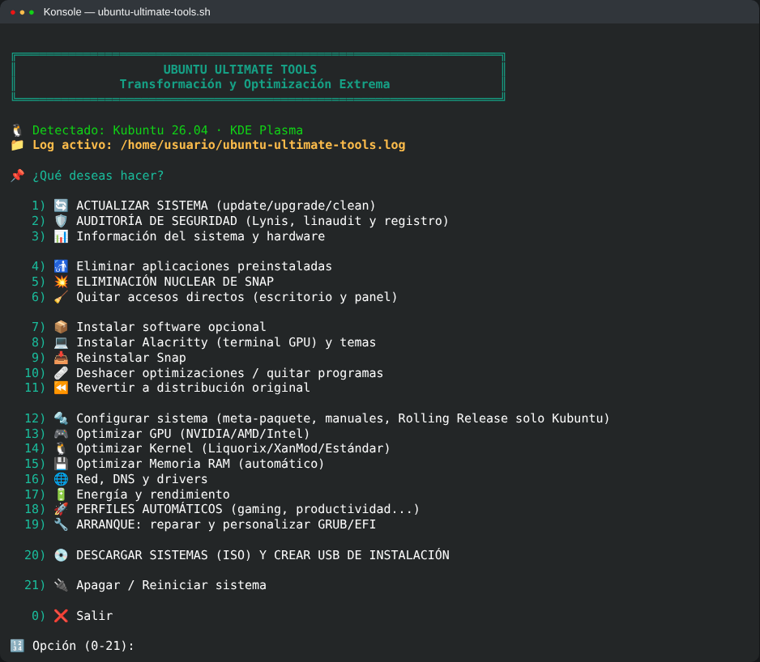

</div>

---

## 🐧 Ubuntu: sabores compatibles

| Sabor | Escritorio | Notas |
|-------|------------|-------|
| **Ubuntu** (completo o mínimo) | GNOME | Modo oscuro, dock e indexador de GNOME |
| **Kubuntu** | KDE Plasma | Tema Tokyo Night, panel de Plasma, Baloo y KDE Rolling Release (backports, solo Kubuntu) |
| **Xubuntu** | Xfce | |
| **Lubuntu** | LXQt | |
| **Ubuntu MATE** | MATE | |
| **Ubuntu Budgie** | Budgie | |
| **Ubuntu Cinnamon** | Cinnamon | |
| **Ubuntu Unity** | Unity | |
| **Ubuntu Studio** | KDE Plasma | Igual que Kubuntu, salvo Rolling Release |
| **Edubuntu** | GNOME | Igual que Ubuntu |
| **Ubuntu Kylin** | UKUI | Sin lista propia de apps: solo las comunes |
| **Ubuntu Server** | sin escritorio | Kernel, GRUB, red, RAM, Snap y actualizaciones. **Opción 7: instalar un escritorio** |

El sabor se detecta por su meta-paquete (`kubuntu-desktop`, `xubuntu-desktop`...). Si lo quitaste con la
opción 12, se reconoce por su escritorio. Las opciones que no aplican a tu escritorio lo explican y no hacen nada.

---

## 🧪 Versiones BETA para Debian y Arch

Los scripts de Debian y Arch están en **versión beta**: el de Debian ya se probó en un equipo real (GoldenDog
Linux, base Debian 13) y el de Arch, por ahora, solo con sistemas simulados. Úsalos con cuidado y reporta lo que
falle. Tienen el mismo menú y **los mismos números** que el de Ubuntu (ver la tabla de la [Descripción](#-descripción)).

**Qué traen las betas:** actualizar, auditoría de seguridad, información del sistema, eliminar apps y accesos
directos, software opcional, Alacritty y temas, deshacer, revertir, configuración, GPU y drivers, kernel,
RAM/ZRAM, red y DNS, energía (incluidos Steam, Proton y herramientas de juego), el menú de arranque completo y
crear un USB de instalación.
**Todavía no:** los perfiles automáticos (18). Snap (5 y 9) no aplica en Debian ni en Arch.

### Debian (beta)

- **Repositorios (12):** activa `contrib`, `non-free` y `non-free-firmware` (drivers de NVIDIA, firmware de Wi-Fi,
  Steam) en el formato clásico y en el nuevo (`*.sources`). Desactiva el DVD/USB de instalación como fuente.
  Activa **backports**. Antes guarda una copia y, si `apt update` falla, vuelve atrás solo.
- **GPU (13):** NVIDIA con `nvidia-detect` (elige el driver correcto; avisa del paso de Secure Boot/MOK); AMD e
  Intel con su firmware y los drivers de vídeo.
- **Kernel (14):** oficial, **backports** (más nuevo y firmado), Liquorix y XanMod.
- **Eliminar apps (4):** en Debian los metapaquetes del escritorio dependen de las apps; antes de quitar una, se
  protege lo que quedaría huérfano para que `apt autoremove` no se lleve medio escritorio.
- **Si falta `sudo`** (instalaste con contraseña de root) explica cómo agregarlo.

### Arch (beta)

- **Paquetes:** nunca hace actualizaciones parciales. Si la base de paquetes está vieja (error 404) ofrece
  actualizar todo y reintentar; si fallan las firmas, actualiza el llavero; si `pacman` quedó bloqueado por un
  corte (y no hay nada instalándose), ofrece desbloquearlo.
- **Software opcional (7):** solo **repositorios oficiales** y **Flathub** (preguntando antes). Chrome, Brave, Spotify y
  el VS Code de Microsoft salen de Flathub; Firefox, Chromium y la versión libre de VS Code, de los oficiales.
- **Sin AUR:** el script no lo usa (cualquiera puede subir paquetes y ya hubo casos con malware). Tampoco
  actualiza paquetes del AUR que tengas instalados por tu cuenta.
- **Configurar (12):** multilib (con vuelta atrás si falla), descargas en paralelo, servidores más rápidos
  (`reflector`; en Manjaro, `pacman-mirrors`) y limpieza automática de la caché.
- **GPU (13):** NVIDIA según la tarjeta (`nvidia-open`, o DKMS si tienes otros kernels); en Manjaro usa `mhwd`.
  Las anteriores a la serie 16/RTX necesitan un driver que solo está en el AUR: el script lo explica y deja el
  driver libre (nouveau). AMD e Intel con lib32 si hay
  multilib. Regenera la imagen de arranque con `mkinitcpio` o `dracut` (EndeavourOS).
- **Kernel (14):** `linux`, `linux-lts` y `linux-zen` (con sus headers); en Manjaro, `mhwd-kernel`. Nunca quita
  el kernel en uso. Microcódigo del procesador.
- **ZRAM** con `zram-generator`; **TLP** quita antes `power-profiles-daemon` (en Arch chocan); **Steam** desde
  multilib (o Flathub si no lo quieres activar).

**Las dos:** si no está `systemd-resolved` (lo normal en Debian y Arch), el DNS se cambia con NetworkManager.
Si faltan `wget` o `lspci`, se instalan solos cuando hacen falta.

---

## 📋 Requisitos

- **Ubuntu 22.04 LTS o superior** (cualquier sabor y derivadas), **Debian 12 o superior** (y derivadas) o
  **Arch** y derivadas; el menú de arranque y crear un USB también en Fedora, openSUSE y otras
- Conexión a internet
- Usuario con privilegios `sudo`

---

## 🔧 Instalación

### 1. Descargar

**Opción A: todo el repositorio con Git** (recomendado: se actualiza con `git pull`)

```bash
git clone https://github.com/george0884/linux-ultimate-tools.git
cd linux-ultimate-tools
```

**Opción B: solo el script de tu distribución**

```bash
wget https://raw.githubusercontent.com/george0884/linux-ultimate-tools/main/ubuntu-ultimate-tools.sh
# o debian-ultimate-tools.sh / arch-ultimate-tools.sh
```

**Opción C: desde la web**: en la página del repositorio, **Code → Download ZIP**, y descomprímelo.

💡 El repositorio antes se llamaba `ubuntu-ultimate-tools`: los enlaces viejos y `git pull` en copias anteriores
siguen funcionando (GitHub redirige al nombre nuevo).

### 2. Dar permisos de ejecución

```bash
chmod +x *-ultimate-tools.sh
```

### 3. Ejecutar

```bash
./ubuntu-ultimate-tools.sh     # Ubuntu, Mint, Pop!_OS...
./debian-ultimate-tools.sh     # Debian y derivadas (beta)
./arch-ultimate-tools.sh       # Arch, Manjaro, EndeavourOS... (beta)
```

💡 No hay que ejecutarlo como root: pide la contraseña de `sudo` cuando hace falta. La primera vez muestra un
[aviso](#aviso-del-primer-uso) con la licencia y lo que hace.

---

## 🚀 Perfiles automáticos

Aplican varias optimizaciones de una vez, sin preguntas intermedias. Se eligen desde el menú (opción 18)
o desde la terminal. Por ahora solo en el script de Ubuntu:

```bash
./ubuntu-ultimate-tools.sh --perfiles                  # lista los perfiles
./ubuntu-ultimate-tools.sh --perfil gaming             # muestra el plan y pide una confirmación
./ubuntu-ultimate-tools.sh --perfil productividad --si # sin confirmación
```

| Perfil | Qué hace |
|--------|----------|
| `productividad` | Actualiza, quita juegos, instala git/htop/timeshift..., RAM + ZRAM, TRIM, DNS más rápido, TCP BBR |
| `gaming` | **Steam + Proton** (activado para todos los juegos) y Proton-GE, drivers recomendados, kernel Liquorix, GameMode + MangoHud, energía al máximo, sin Baloo, Wi-Fi sin ahorro, BBR, DNS |
| `gaming-extremo` | **Al estilo CachyOS (parecido, no idéntico)**: todo lo de `gaming` con **kernel XanMod compilado para tu procesador** (x86-64-v2/v3/v4) en vez de Liquorix, y además: **prioridad para los juegos** (ananicy-cpp con las reglas de CachyOS si tu Ubuntu lo trae; si no, GameMode con prioridad alta), **Wine + winetricks**, ajustes de memoria y kernel de SteamOS/CachyOS (`vm.max_map_count`, sin penalización de *split lock*…), **planificador de disco según el tipo** (NVMe, SSD o disco rígido), **ntsync** para Wine/Proton (kernel 6.14+) y el planificador de CPU para juegos **scx_lavd** (sched-ext) si tu kernel y tus repositorios oficiales lo traen |
| `ahorro` | TLP en portátiles (perfil de ahorro en PC), sin Baloo, ZRAM, RAM, TRIM |
| `desarrollo` | git, build-essential, Python, VSCode, **SDK de Android para compilar APK**, más vigilancia de archivos para IDEs, RAM, ZRAM, BBR, DNS |
| `minimalista` | Mínimo: sin el meta-paquete del sabor ni apps extra, sin Snap, Firefox .deb de Mozilla (en KDE, Plasma de backports) |

- Si un paso falla, el perfil sigue con los demás y al final muestra un resumen ✓/✗.
- Las preguntas internas (por ejemplo, instalar CUDA) se responden "no" automáticamente.
- El perfil `gaming` omite Liquorix si Secure Boot está activado (y `gaming-extremo`, XanMod).
- **`gaming-extremo` no es CachyOS**: CachyOS además recompila *todo* el sistema para tu procesador, y eso no se
  puede copiar en Ubuntu. Lo que no está en tus repositorios oficiales (ananicy-cpp, sched-ext) se omite con un aviso:
  no se usan PPAs experimentales. Todos sus ajustes se deshacen en **10 → 14** (o en 10 → 5, con el resto); los
  programas, en 10 → 1. Para algo más "pelado", aplica antes el perfil `minimalista`.
- El perfil `minimalista` copia antes los perfiles de Firefox/Thunderbird del snap para no perder marcadores.

---

## 🌐 Red, DNS y drivers (opción 16)

- **DNS**: Cloudflare, Cloudflare con bloqueo de malware, Google, Quad9 o AdGuard (bloquea anuncios), con DNS
  cifrado cuando el servidor lo permite. También puede **medir cuál responde más rápido** desde tu conexión.
  Si con el DNS elegido no se resuelven nombres, vuelve solo al automático.
- **TCP BBR**: mejora velocidad y latencia, sobre todo en Wi-Fi y conexiones inestables.
- **Wi-Fi sin ahorro de energía**: evita picos de latencia y microcortes.
- **Drivers**: instala los recomendados por Ubuntu para tu hardware (NVIDIA, Wi-Fi Broadcom, etc.).
- **Firmware**: actualiza BIOS/UEFI, SSD y otros dispositivos con `fwupd`.

> Un DNS rápido acelera el inicio de cada página, pero no aumenta los Mbps contratados.

---

## 💾 Memoria RAM y swap (opción 15)

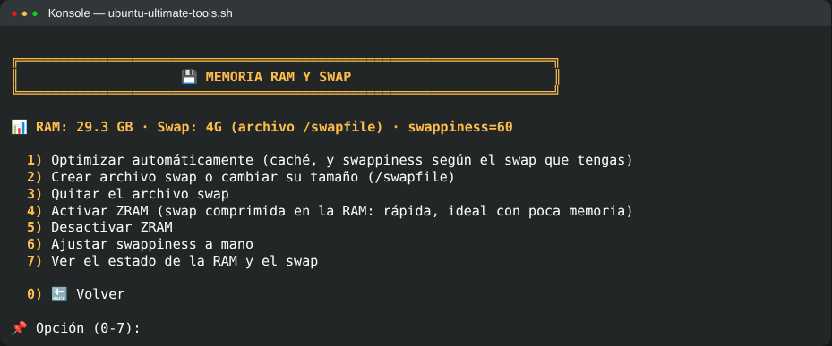

| Opción | Qué hace |
|---|---|
| **1** Optimizar automáticamente | Caché de archivos (`vfs_cache_pressure=50`) y `swappiness` **según el swap que tengas**: con ZRAM, 100 (conviene usarla antes que el disco); con swap en disco, 10 (solo cuando la RAM se llena); **sin swap no se toca**, porque no tiene efecto |
| **2** Crear archivo swap | `/swapfile` del tamaño que elijas (sugiere uno según tu RAM). Comprueba el espacio libre, funciona en **btrfs** y lo deja en `fstab` para que siga al reiniciar. También cambia el tamaño de uno existente |
| **3** Quitar el archivo swap | Solo `/swapfile` y su línea de `fstab`: las particiones swap y la ZRAM quedan como estaban. Antes comprueba que la RAM libre alcance |
| **4–5** ZRAM | Swap comprimida en la RAM (rápida, ideal con poca memoria); al activarla o desactivarla, `swappiness` se reajusta sola |
| **6** swappiness a mano | Valor de 0 a 200 |
| **7** Estado | RAM, swap y los valores actuales |

El archivo swap está basado en [create-swap](https://github.com/george0884/create-swap), del mismo autor, con más
seguridad: nunca borra otras líneas de swap de `fstab` ni apaga la ZRAM, y guarda una copia de `fstab` antes del
primer cambio (`/etc/fstab.antes-de-ultimate-tools`).

---

## 🔋 Energía y rendimiento (opción 17)

Perfiles rendimiento / equilibrado / ahorro, TLP para portátiles, activar o desactivar el indexador
de archivos Baloo, y herramientas de juego: GameMode, MangoHud, Steam y Proton-GE.

MangoHud queda configurado: muestra los FPS en el juego y los graba en ~/mangohud-logs (SysMonitorPro los lee).
Opcionalmente (y siempre en el perfil `gaming`) se activa en todos los juegos Vulkan/Proton sin tocar Steam.
Shift derecho + F12 oculta el panel · Shift izquierdo + F2 pausa/reanuda la grabación.

### 🎮 Steam y Proton

- **Steam**: se instala el `.deb` oficial de Valve y se activan las librerías de 32 bits (`i386`) que necesitan
  Steam y los juegos, incluida la parte de 32 bits del driver de NVIDIA si lo usas.
- **Proton** viene dentro de Steam. El script lo activa para **todos los juegos** (Proton Experimental):
  si Steam todavía no se abrió nunca, ábrelo una vez, inicia sesión, ciérralo y usa la opción 17 → 6;
  o actívalo a mano en *Steam → Configuración → Compatibilidad*. Si ya elegiste una versión, no se cambia.
- **Proton-GE**: la última versión se descarga de la página oficial del proyecto, se comprueba que llegó
  entera (suma SHA-512) y se instala en `compatibilitytools.d`. Se elige por juego en
  *Propiedades → Compatibilidad*. Funciona también con Steam de Flatpak.
- Se quitan desde la opción 10: Steam en "Quitar programas" y Proton-GE en "Quitar Proton-GE".

---

## 🔧 Arranque: reparar y personalizar GRUB/EFI (opción 19)

Todo lo hace el propio script, sin instalar programas externos.

**Funciona en cualquier Linux con GRUB**, no solo en Ubuntu:

| Distribución | Cómo regenera el menú | Paquetes | Partición EFI |
|---|---|---|---|
| Ubuntu y sabores, Debian, Mint | `update-grub` | apt (con shim firmado) | `/boot/efi` |
| Arch, Manjaro, EndeavourOS | `grub-mkconfig` (Manjaro: `update-grub`) | pacman | `/boot/efi`, `/efi` o `/boot` |
| Fedora | `grub2-mkconfig` (entradas BLS con `grubby`) | dnf (con shim firmado) | `/boot/efi` |
| openSUSE | `grub2-mkconfig` y `shim-install` | zypper | `/boot/efi` |

- **El menú muestra solo lo que sirve en tu equipo** (los números no cambian, así la tarjeta de rescate y las
  guías siguen valiendo):
  - **UEFI:** partición EFI, orden de arranque UEFI y arranque de respaldo; se oculta "Instalar en otro disco".
  - **BIOS (Legacy):** "Instalar en otro disco"; se ocultan las opciones de EFI y UEFI.
  - **Desde un Live USB:** la reparación del sistema del disco (10), las guías, el diagnóstico y el orden UEFI.
  - **Sin GRUB (systemd-boot):** diagnóstico, partición EFI, orden UEFI y guías.
  - Si escribes el número de una opción oculta, el script explica por qué no aplica.
- El script detecta la distribución, la carpeta de GRUB (`/boot/grub` o `/boot/grub2`), dónde está montada la
  partición EFI y cómo se llama su carpeta (`ubuntu`, `debian`, `GRUB`, `manjaro`, `fedora`...).
- **En Ubuntu y sus derivadas** (Kubuntu, Mint, Pop!_OS...) está todo el script. **En las demás distribuciones**
  el menú principal muestra solo **19) Arranque**, **20) Descargar sistemas y crear USB de instalación** y **21) Apagar**, con los mismos números, así la tarjeta de
  rescate y las guías sirven igual.
- Desde el USB de cualquiera de estas distribuciones, la **reparación desde Live USB (19 → 10)** detecta qué
  sistema hay en el disco y usa sus comandos (también con btrfs, `/boot` aparte y discos cifrados).
- Si el sistema usa **systemd-boot** en lugar de GRUB (algunos Arch y EndeavourOS), el script lo detecta y lo
  avisa: siguen sirviendo el diagnóstico, la partición EFI, el orden UEFI y las guías.
- En **Fedora** los kernels van en formato BLS: el sistema por defecto se elige con `grubby` y los kernels no se
  pueden ocultar uno por uno (Windows, memtest y la configuración UEFI sí).
- En **Arch y Manjaro** GRUB no viene firmado: con Secure Boot activo el script avisa que hay que desactivarlo o
  firmarlo.

| | Opción | Qué hace |
|---|---|---|
| 🔍 | **1** Diagnóstico | Estado del arranque: modo UEFI/BIOS, Secure Boot, discos, kernels, configuración de GRUB, menú, entradas UEFI y partición EFI. Lo guarda en `~/diagnostico-arranque.txt` para compartirlo |
| 🔧 | **2** Reparación rápida | Reinstala GRUB y regenera el menú |
| | **3** Reparación completa | Verifica la partición EFI, reinstala los paquetes de GRUB (y shim), reinstala GRUB, regenera el menú, pone tu sistema primero en UEFI y comprueba el resultado |
| | **4** Instalar GRUB en otro disco | Solo en modo BIOS |
| | **5** Partición EFI | Espacio libre, sistemas registrados y verificación/reparación con `fsck.vfat` |
| 🎨 | **6** Sistema por defecto | Qué entrada arranca sola y cuántos segundos espera el menú |
| | **7** Otros sistemas | Detectar Windows y otras distros (`os-prober`, que Ubuntu, Debian y Arch traen desactivado) |
| | **8** Orden de arranque UEFI | Poner una entrada primera, o arrancarla solo la próxima vez |
| | **9** Personalizar menú | **Ocultar cualquier entrada** marcándola con la barra espaciadora (cada kernel, Windows, cada memtest, UEFI...), mostrar otros sistemas antes que Kubuntu, recordar el último elegido, colores, imagen de fondo, resolución, parámetros del kernel, **restaurar el menú original** y **deshacer los cambios de Grub Customizer** |
| | **16** Arranque detallado (verbose) | **Quita la pantalla de carga (splash, la dibuja Plymouth) y el arranque silencioso (quiet)**, que tapan los errores: ves cada paso del sistema al encender y en qué se traba. Reconoce `quiet splash` (Ubuntu, Debian), `rhgb quiet` (Fedora, también en cada kernel con `grubby`), `splash=silent` (openSUSE) y `loglevel=3` (Arch). Recuerda cómo estaba y la misma opción **restaura la pantalla de carga**. En Ubuntu y Debian usa un archivo propio en `/etc/default/grub.d/` (no toca `/etc/default/grub` y respeta los ajustes de las imágenes de la nube) |
| 🚑 | **10** Reparar desde Live USB | Reparación automática con chroot cuando el sistema no arranca |
| | **11–13** Guías | Prompt `grub>`, `grub rescue>` y reparación manual desde Live USB. Las de `grub>` y `grub rescue>` muestran primero **los comandos exactos de tu PC** y luego cómo hacer que GRUB busque solo dónde está Ubuntu |
| 🛟 | **14** Tarjeta de rescate | Los comandos exactos de **tu** PC para `grub>` y `grub rescue>`, para fotografiar y copiar al pendrive junto con el script |
| | **15** Arranque de respaldo UEFI | Que la PC arranque aunque la BIOS pierda la entrada de tu sistema (en Fedora y openSUSE ya viene: solo se comprueba) |

Antes del primer cambio, el script guarda una copia de `/etc/default/grub`
(`/etc/default/grub.ubuntu-ultimate-tools.orig`; en Debian y Arch, `debian-…` o `arch-…`) para poder volver al
menú original.

Para ocultar entradas sueltas, el script desactiva el script de GRUB que las genera y en su lugar
ejecuta `<script>_ubuntu_ultimate_tools`, que lo llama y quita las entradas de la lista
`/etc/ubuntu-ultimate-tools/grub-ocultas`. Si una actualización reactiva el original, el filtro se aparta
(sin entradas duplicadas) hasta que se vuelva a usar la opción. No se pueden ocultar todas las
entradas de tu sistema.

Si usaste **Grub Customizer**, la opción 19 → 9 → 7 deja `/etc/grub.d` como lo instala Ubuntu: devuelve
cada script a su nombre, quita sus `*_proxy` (que duplican entradas) y guarda antes una copia
completa en `/etc/grub.d.antes-de-deshacer-grub-customizer-<fecha>`.

La reparación automática desde Live USB:

- Detecta UEFI o BIOS, lista las particiones de Linux y desbloquea discos cifrados (LUKS/LVM).
- Monta la raíz (también btrfs con subvolumen `@`), `/boot` y la partición EFI según el `fstab` del sistema.
- Prepara el chroot (`/dev`, `/dev/pts`, `/proc`, `/sys`, `/run`, `efivars`), ejecuta `grub-install` y `update-grub`.
- Si `grub-install` falla, ofrece reinstalar los paquetes de GRUB y reintentar.
- Al final desmonta todo, también si algo falla a mitad de camino.

#### Prepárate antes de necesitarlo

Con el sistema funcionando, usa la opción 19 → 14 y la 19 → 15. Son tres pasos:

1. **Tarjeta de rescate (19 → 14).** Calcula los comandos exactos para tu PC: el nombre que GRUB le da a
   tu partición (por ejemplo `(hd0,gpt2)`), su UUID y las rutas del kernel. Funciona con ext4, btrfs y
   `/boot` en partición aparte.
   - **Sácale una foto con el celular**: cuando aparece `grub>` no puedes abrir archivos de tu disco.
   - Se guarda en `~/tarjeta-rescate-arranque.txt` y en la partición EFI, que se puede leer desde un
     Live USB o desde Windows.
   - Se actualiza sola cada vez que el script cambia GRUB.
2. **Pendrive.** En esa misma opción, el script copia **la tarjeta y el propio script** al pendrive que
   elijas. Así lo tienes a mano aunque el Live USB no tenga internet.
3. **Arranque de respaldo UEFI (19 → 15).** El firmware guarda una lista de sistemas para arrancar, y
   a veces la pierde: al actualizar la BIOS, por un reseteo o al cambiar el disco de PC. Entonces la PC
   no arranca o va directo a Windows, aunque Ubuntu esté bien.
   - El script copia el arranque de Ubuntu a la ruta de emergencia `EFI/BOOT/BOOTX64.EFI`, la que el
     firmware prueba cuando no encuentra nada.
   - Ubuntu arranca igual por esa ruta y **vuelve a crear su entrada solo**.
   - Funciona con Secure Boot y se mantiene al día con cada actualización (un hook de apt).
   - Si esa ruta la usa Windows, no se toca. Si la usaba otro sistema, se guarda una copia y al
     quitarlo vuelve como estaba.
   - La reparación completa (19 → 3) también lo ofrece.

Ten a mano también un **USB de instalación de tu distribución** (el Live USB): lo puedes descargar y crear con la opción 20.

#### Cuando el sistema no arranca

1. Arranca desde el USB y elige **"Probar Ubuntu"** (o "Probar Kubuntu", "Live system" en Debian...).
   Debe arrancar en el mismo modo que el sistema instalado (UEFI o BIOS/Legacy).
2. Conecta el pendrive con el script. Aparece en el gestor de archivos (Dolphin, Nautilus...);
   haz clic en él para montarlo.
3. Abre una terminal y ejecuta (cambia `PENDRIVE` por el nombre de tu pendrive;
   la tecla TAB lo autocompleta):

```bash
cd /media/$USER/PENDRIVE
bash ubuntu-ultimate-tools.sh      # opción 19 → 10 (o el script de tu distribución)
```

- Se usa `bash …` y no `./…` porque los pendrives FAT32/exFAT no guardan el permiso de ejecución.
- `ls /media/$USER/` muestra el nombre exacto del pendrive.
- Si el Live USB tiene internet, no hace falta pendrive: descárgalo con `wget` (ver *Instalación*) y ejecútalo
  con `bash`.

---

## ☑️ Selección con barra espaciadora

En "Eliminar aplicaciones" (opción 4) y "Software opcional" (opción 7) las listas usan casillas:
**Espacio** marca o desmarca, **flechas** para moverse, **Enter** para aceptar. La lista de eliminación
solo muestra las apps instaladas, y la de software marca las que ya tienes.

- Con **`dialog`** la **línea donde está el cursor se resalta** al moverte con las flechas. La primera vez que se
  usa una lista, si no está instalado, el script ofrece instalarlo (~300 KB, repositorios oficiales; se quita en
  10 → 1). Si no lo quieres, se usa `whiptail`, que viene en todas las distros pero solo marca la casilla del cursor.
- El recuadro se ajusta al ancho de la terminal y las descripciones largas se recortan con "…": nada se sale del
  borde.
- Si no hay ninguno de los dos, o no es una terminal interactiva, se elige escribiendo números (0 o Enter = volver).

---

## ↩️ Deshacer optimizaciones (opción 10)

- **Quitar programas instalados por el script**, con casillas. El script anota en
  `~/.local/share/<script>/paquetes-instalados.txt` (por ejemplo `ubuntu-ultimate-tools`) solo los programas que
  **no tenías antes**;
  los instalados con versiones anteriores del script aparecen marcados "sin registro".
  Antes de desinstalar avisa si se quitará algo más por dependencias.
- **Restaurar ajustes del sistema** (RAM, inotify, BBR...) a sus valores de fábrica.
- **Desactivar ZRAM** y **quitar TLP** (vuelve el selector de energía del escritorio).
- **Quitar Proton-GE** (las versiones que instaló el script).
- **Quitar Android Studio y/o el SDK de Android**, y **los SDK de Flatpak**.
- **Quitar Docker**: solo los programas o la eliminación nuclear (con respaldo).
- ☢️ **Eliminación nuclear de desarrollo**: Android Studio, SDK, SDK de Flatpak, Docker, JDK y
  flatpak-builder de una vez, con doble confirmación y respaldos antes. Tus proyectos, tus claves de firma y
  tus apps Flatpak no se tocan.
- **Quitar el escritorio instalado por el script** (11, solo Ubuntu): solo sus paquetes; el arranque y la red
  vuelven a como estaban.
- **Quitar otros escritorios** (12, solo Ubuntu): los que no instaló el script (por ejemplo uno puesto a mano).
  Nunca ofrece el original del sabor ni el que está abierto, deja la pantalla de inicio de sesión en uso y solo
  quita lo que ese escritorio dejó de usar. Si se llevara algo de otro escritorio, la red o el sonido, no quita nada.
- **Quitar el registro de auditoría** (Ubuntu 13; Debian y Arch 11): borra las reglas de auditd del script y, si
  lo instaló, auditd.
- **Restaurar todos los ajustes** de una vez, sin desinstalar programas. "Revertir a
  distribución original" (opción 11) también lo hace.

---

En todos los menús y submenús, **0** vuelve al menú anterior (en el principal, sale del script). En las preguntas
**s/n** también: **0** vuelve al menú principal en ese momento, sin seguir con las demás preguntas (lo que ya se
hizo queda hecho).

---

## 🖥️ Información del sistema y hardware (opción 3)

| | Opción | Qué muestra |
|---|---|---|
| 👀 | **1** Resumen rápido | Sabor, kernel, CPU, GPU, RAM, disco, tiempo encendido y temperatura. Sin internet ni instalar nada |
| | **2** Fastfetch | El instalado o, si no lo tienes, uno **temporal** (descarga oficial que se borra al terminar) |
| | **3** inxi | Igual: el instalado o el paquete oficial de tu distribución usado **sin instalar**. Nivel normal o muy detallado |
| 🔩 | **4** CPU y RAM | Modelo, núcleos, frecuencias y **cada módulo de RAM** (tamaño, tipo, velocidad, ranuras libres) |
| | **5** Gráfica | Modelo y **driver en uso**; avisa si una NVIDIA usa el driver libre |
| | **6** Discos | Particiones, espacio y **salud SMART** (horas de uso, desgaste, errores; instala `smartmontools` si hace falta) |
| | **7** Temperaturas | CPU, GPU, discos y ventiladores, leídos del kernel |
| | **8** Red | IP, Wi-Fi (señal y velocidad), velocidad del enlace, DNS y TCP |
| | **9** Batería | Carga, **salud** (capacidad frente a la original) y ciclos |
| | **10** USB | Dispositivos conectados |
| 🩺 | **11** Diagnóstico | Servicios que fallaron, errores del último arranque, qué hace lento el arranque y procesos que más consumen |
| | **12** Cambios del script | Kernel, GRUB, apps quitadas e instaladas y todos los ajustes aplicados |
| 🧰 | **13** Buscar | Escribe una palabra (nvidia, temp, wifi, error...) y la busca en **toda** la información |
| | **14** Guardar informe | Todo en `~/informe-sistema-<fecha>.txt`, **sin datos personales** (números de serie, MAC, IP, UUID, usuario, equipo y Wi-Fi) |
| | **15** Rendimiento | Velocidad de lectura y escritura del disco, latencia y velocidad de descarga |
| 🩺 | **16** Procesos en vivo | **htop**: qué consume CPU y memoria, con colores y por núcleo. Si no lo tienes, ofrece instalarlo (~400 KB); si no, usa `top` |

---

## 🛡️ Auditoría de seguridad (opción 2)

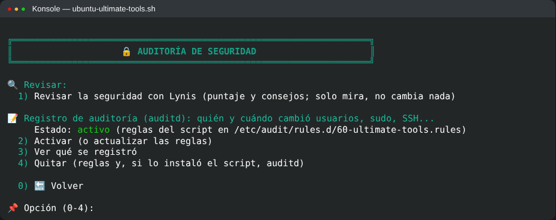

| Opción | Qué hace |
|---|---|
| **1** Revisar con Lynis | Revisa la seguridad (usuarios, SSH, cortafuegos, servicios, permisos, kernel...) y da un **puntaje** con advertencias y consejos. **Sin instalar** (Ubuntu y Debian) o instalado |
| **2** Revisar con linaudit | [linaudit](https://lexiworks.dev/linaudit) de **Alexia Michelle**: más de 100 controles **en castellano**, puntaje de 1 a 10 y cómo arreglar cada cosa. Como todavía no publica programas listos, se **compila en una carpeta temporal** (con Rust temporal si hace falta) y se borra todo; al final puedes dejarlo instalado |
| **3** Activar registro | **auditd** con reglas propias: quién y cuándo cambió usuarios, contraseñas, sudo, SSH, hora, red, tareas, servicios, repositorios y módulos del kernel |
| **4** Ver qué se registró | Resumen por categoría y últimos cambios en usuarios, sudo y SSH |
| **5** Quitar registro | Borra las reglas y, si lo instaló el script, auditd y sus registros |
| **6** Quitar linaudit | Si lo dejaste instalado: borra el programa y su manual |

- **Lynis** ([CISOfy](https://cisofy.com/lynis/), GPL-3.0) solo **revisa**: no cambia nada. El resumen sale en castellano
  (puntaje, advertencias y sugerencias) y el informe completo queda en `~/auditoria-seguridad/<fecha>/`
  (solo lo puede leer tu usuario: contiene datos del sistema, no lo compartas en público). Usado sin instalar,
  se borra al terminar y no deja nada; instalado (en Arch siempre, desde sus repositorios oficiales), se quita en 10 → 1.
- **linaudit** ([Alexia Michelle](https://github.com/alexiarstein/linaudit), AGPL-3.0) también **solo revisa**. Usa el
  programa si ya lo tienes, el paquete de la distro cuando llegue a los repositorios, o lo compila:
  - baja el código oficial (`git clone`, o el `.tar.gz` si no hay git) a `/var/tmp/linaudit.*`;
  - usa tu Rust si es 1.85 o más nuevo; si no, baja **rustup oficial** (verificado con su SHA-256) dentro de esa
    misma carpeta, sin tocar tu sistema ni tu `~/.cargo`;
  - si no tienes compilador de C, ofrece instalar `gcc` (queda registrado, se quita en 10 → 1);
  - necesita ~3 GB libres y tarda de 5 a 15 minutos; al terminar **borra la carpeta entera**;
  - si eliges dejarlo instalado: `/usr/local/bin/linaudit` y su manual en castellano (`man linaudit`), con la
    versión (commit) anotada; se quita en 2 → 6.
- **auditd** usa reglas **propias del script** en `/etc/audit/rules.d/60-ultimate-tools.rules`:
  - solo vigila archivos que existen y llamadas que existen en tu procesador;
  - **sin `-e 2`**: las reglas nunca quedan bloqueadas hasta reiniciar, y nunca provoca un *kernel panic*;
  - si el sistema no las acepta (por ejemplo en un contenedor o WSL), se quitan solas y todo queda como estaba.
  - **Ver qué se registró**: resumen por categoría y los últimos cambios en usuarios, sudo y SSH.
  - **Quitar**: 2 → 5 (o Deshacer: Ubuntu 10 → 13, Debian y Arch 10 → 11) borra las reglas; si auditd lo instaló el script, ofrece desinstalarlo y
    borrar sus registros.
**Lynis (opción 1)**: puntaje, advertencias y sugerencias:

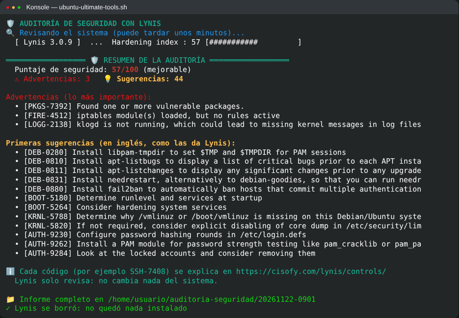

**linaudit (opción 2)**: primero pregunta qué tipo de equipo es y después muestra el puntaje de 1 a 10, cada
categoría y lo más urgente; con Enter se abre el detalle de cada hallazgo y cómo arreglarlo:

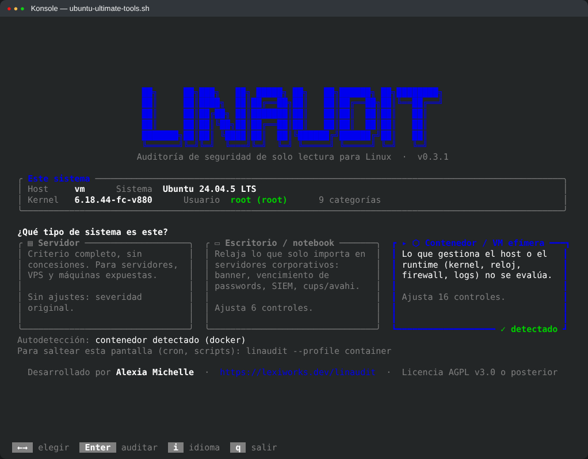

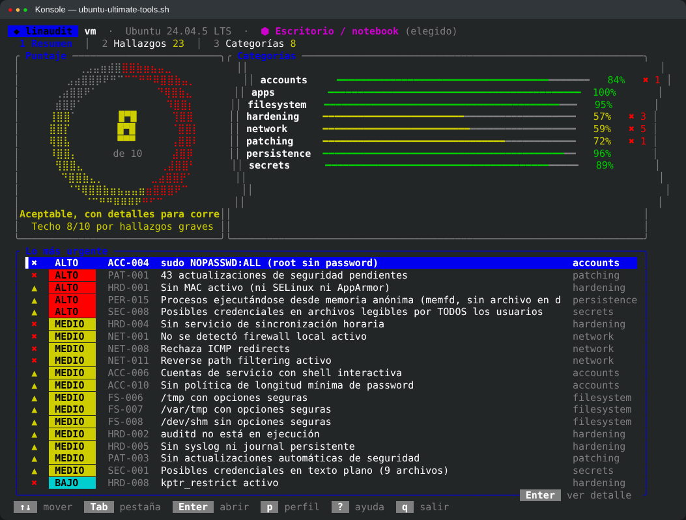

*(Capturas de linaudit 0.3.1 de verdad, en un equipo de prueba: los hallazgos dependen de cada sistema.)*

- Idea inspirada en [Linux-Security-Policy](https://github.com/Starke427/Linux-Security-Policy) de Jeff Starke
  (Starke427). No se usa su código porque su repositorio no tiene licencia (ver [CREDITOS.md](CREDITOS.md)).

---

## 💿 Descargar sistemas y crear USB de instalación (opción 20)

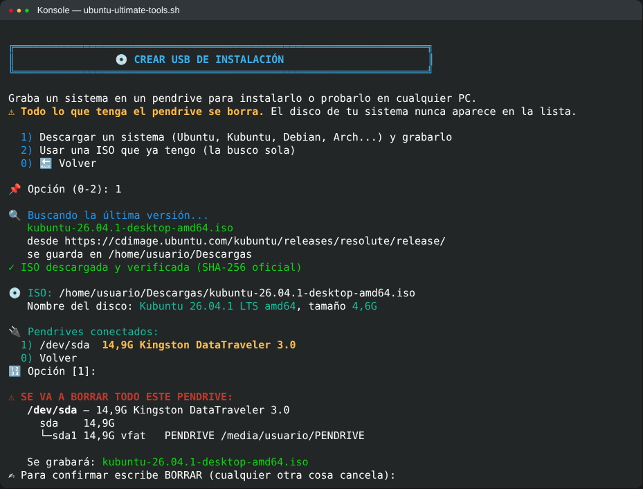

Descarga la imagen (ISO) oficial de un sistema y la graba en un pendrive con `dd`, pensado para que lo use cualquiera y
sin riesgo de borrar el disco equivocado. Funciona en todas las distribuciones (también en el modo arranque de Arch,
Fedora, openSUSE...). Tiene cinco opciones:

- **1) Descargar un sistema y grabarlo en un pendrive.**
- **2) Solo descargar la imagen ISO**, para grabarla después, usarla con Ventoy o en una máquina virtual.
- **3) Grabar en un pendrive una ISO que ya tengo.**
- **4) Ventoy**: varios sistemas en un solo pendrive, con persistencia (ver más abajo).
- **5) Probar que todas las descargas funcionen**: revisa los más de 40 sistemas (encuentra cada ISO y su suma oficial y comprueba que el archivo esté en el servidor) sin bajar nada. Si una distribución cambió de lugar sus descargas, aparece con ✗: avísanos en Issues.

1. **Elige la ISO:**
   - **Descargarla**: más de 40 sistemas. Primero eliges la familia y después el sistema. Siempre se baja **la
     versión más nueva** de su sitio oficial (o de un espejo oficial) y **nunca sin su suma oficial**: si la
     distribución no publica la suma, no se descarga.

     | Base | Sistemas |
     |---|---|
     | **Ubuntu** | Ubuntu, Kubuntu, Xubuntu, Lubuntu, Ubuntu MATE, Ubuntu Budgie y Ubuntu Server (la **última LTS se detecta sola**; si un sabor todavía no sacó la nueva, se usa la anterior), **KDE neon** (User, Testing o Unstable; sigue a KDE aunque cambie la carpeta de sus descargas), **Linux Mint** (Cinnamon, Xfce o MATE), **Zorin OS** Core y **Pop!_OS** (normal o NVIDIA) |
     | **Debian** | Debian **estable** (KDE o GNOME live, o netinst), Debian **testing** (KDE live o netinst, se arma cada semana), **LMDE**, **MX Linux** (Xfce o KDE), **GoldenDog Linux** y **Kali Linux** |
     | **Arch** | Arch Linux, **Manjaro** (KDE, GNOME o Xfce), **CachyOS** y **EndeavourOS** |
     | **Fedora y Red Hat** | **Fedora** (Workstation o KDE), **CentOS Stream**, **AlmaLinux** y **Rocky Linux** (compatibles con Red Hat, gratis). **Red Hat Enterprise Linux** pide iniciar sesión con una cuenta gratuita: el script explica cómo bajarla, abre la página y después la comprueba con la opción 3 |
     | **openSUSE** | **Tumbleweed** (siempre al día) y **Leap** (estable) |
     | **Independientes e históricas** | **Slackware** (la más antigua que sigue viva: se comprueba con MD5 y además con la **firma GPG oficial**), **Gentoo** (LiveGUI o mínima), **Void Linux** y **NixOS** |

     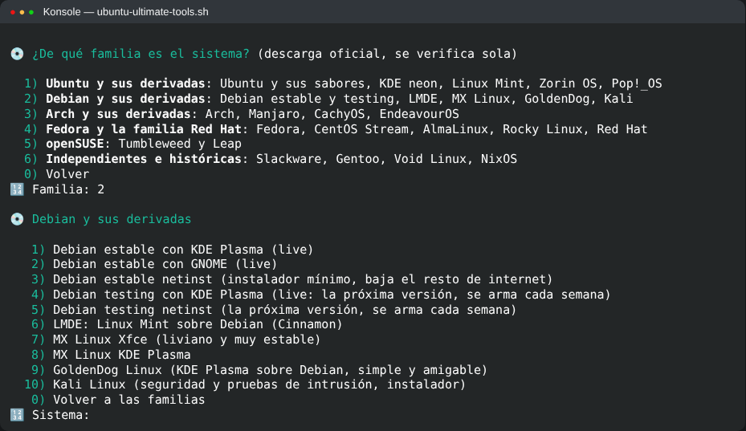

     Se baja a tu carpeta de Descargas, se puede **retomar si se corta** y se **verifica con su SHA-256 o SHA-512
     oficial** (MD5 y firma GPG en Slackware). Si está dañada, se borra y no se usa. Si ya la tenías descargada y entera, no se baja de nuevo.
   - **Una que ya tengas**: la busca sola en Descargas, tu carpeta personal, el Escritorio y discos conectados, o
     escribes la ruta. **También se comprueba su suma**: con un archivo de sumas que esté al lado (`SHA256SUMS`,
     `.sha256`, `.sha512sum`, `CHECKSUM`...), con la **lista oficial** si es de una distribución de la lista (también versiones anteriores de
     Ubuntu), o pegando la suma que publica el sitio de tu distribución. Si no coincide, no se graba; si no hay
     suma, puedes grabarla igual (avisa) o volver.
   - Revisa que sirva para `dd`: las ISO de **Windows** no arrancan así (avisa que uses WoeUSB o Ventoy) y las que no
     son "híbridas" piden confirmación.
2. **Elige el pendrive:** solo aparecen **discos USB y tarjetas SD**. **Nunca** el disco del sistema, ni uno con algo
   del sistema montado (raíz, `/boot`, `/home`, swap, el propio Live USB). Si no hay ninguno conectado, **espera a que
   lo enchufes y lo detecta solo**. Si es más chico que la ISO, no deja seguir; si es muy grande (más de 256 GB),
   avisa que puede ser un disco externo con tus archivos.
3. **Confirma:** muestra el modelo, el tamaño y las particiones con su nombre, y hay que **escribir `BORRAR`**.
   Justo antes de grabar comprueba que sigue siendo el mismo pendrive.
4. **Graba y comprueba:** desmonta sus particiones, graba con `dd` mostrando el progreso, **compara la copia con la
   ISO** byte a byte y lo **expulsa**. Al final explica cómo arrancar desde el USB (F12, F11, F10, F8 o Esc según la
   marca, y Secure Boot) y ofrece borrar la ISO descargada.

### 🧰 Ventoy: varios sistemas en un solo pendrive (20 → 4)

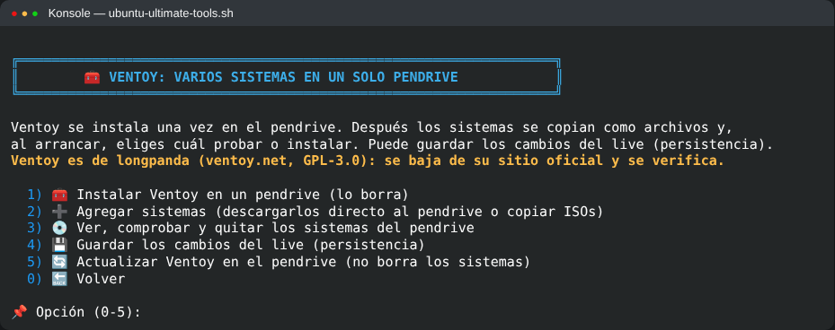

[Ventoy](https://www.ventoy.net) se instala una vez en el pendrive. Después los sistemas se copian como archivos comunes y,
al arrancar, aparece un menú para elegir cuál probar o instalar. El script baja **Ventoy oficial** (de su proyecto en
SourceForge, verificado con su `sha256.txt`) y lo usa con las mismas protecciones de siempre: solo pendrives, nunca el
disco del sistema, y hay que escribir `BORRAR`.

| Opción | Qué hace |
|---|---|
| **1** Instalar Ventoy | En un pendrive (lo borra): MBR (recomendado) o GPT, y compatibilidad con **Secure Boot** (explica cómo registrar la llave la primera vez). Si faltan `fdisk` o `mkfs.vfat`, ofrece instalarlos |
| **2** Agregar sistemas | **Descarga cualquiera de los más de 40 sistemas directo al pendrive**, verificado con su suma oficial, o **copia una ISO que ya tienes** (comprobada antes y después de copiar). Deja la suma al lado de cada ISO y les pone un **nombre claro** en el menú de Ventoy ("Ubuntu 26.04.1") |
| **3** Ver, comprobar y quitar | Lista los sistemas del pendrive con su tamaño y el espacio libre; **comprueba que estén enteros** (también sin internet, con la suma que quedó al lado) y quita los que no quieras, con su persistencia |
| **4** Persistencia | Que el live **guarde los cambios** (programas, archivos, ajustes) entre reinicios: 2, 4, 8 o 16 GB. Ubuntu y sus sabores, Mint, Zorin, Pop!_OS y KDE neon (`casper-rw`); Debian live, LMDE y Kali live (`persistence`) |
| **5** Actualizar Ventoy | A la última versión, **sin borrar los sistemas** |

Los nombres y la persistencia se guardan en `ventoy/ventoy.json`. Si ya tenías un `ventoy.json` hecho a mano, el
script no lo toca y te avisa.

---

## ⏱️ Velocidad

- Las apps se instalan y eliminan **en una sola operación** de apt, no una por una.
- Mientras apt o pacman instalan, quitan o actualizan, se ve una **barra de avance** con el porcentaje, el tiempo
  y el paquete que se está procesando (`[########------]  45%  01:23  Quitando libreoffice-core`), así se sabe que no
  se colgó. El detalle completo queda en el log.
- Los `.deb` externos (VSCode, Chrome, Discord) se descargan en paralelo.
- `apt update` se ejecuta una vez por sesión (o se omite si el sistema lo hizo hace menos de 30 minutos).
- Cambiar de kernel no regenera GRUB: se usa `GRUB_DEFAULT=saved` + `grub-set-default`.
- La opción 12 permite desactivar la indexación de manuales (`man-db`), lo más lento de cada instalación.

---

## ⚡ Cambio de kernel (opción 14)

| Opción | Kernel | Notas |
|--------|--------|-------|
| 1 | Liquorix (basado en Zen) | PPA `damentz/liquorix`, solo amd64 |
| 2 | XanMod | Repositorio oficial de XanMod; elige x64v2/x64v3 según tu CPU |
| 3 | Oficial de Ubuntu | Elige **LTS (GA)**, **HWE** o una **versión específica**; elimina Liquorix/XanMod |
| 4 | Oficial + Livepatch | LTS o HWE + Ubuntu Pro (solo versiones LTS, requiere Snap) |

Dentro de la opción 3:

- **LTS / GA** (`linux-generic`): el kernel con el que salió la versión de Ubuntu. Máxima estabilidad.
- **HWE** (`linux-generic-hwe-XX.04`): kernel más reciente para hardware nuevo (solo en versiones LTS).
- **Versión específica**: lista las 15 versiones oficiales más recientes y GRUB arranca siempre la elegida.
- Al final se puede dejar **solo esa versión**, borrando el resto de kernels oficiales.
- El kernel en uso nunca se borra en caliente: se elimina al reiniciar y volver a abrir el script.

- Liquorix y XanMod **no están firmados**: requieren **Secure Boot desactivado** (el script lo comprueba).
- El kernel oficial se conserva siempre como respaldo. Si un kernel no arranca, elige el `generic`
  en *Opciones avanzadas* de GRUB (Shift/Esc al encender) y usa la opción 3.
- Los errores se muestran en pantalla y el detalle completo queda en el log (`~/ubuntu-ultimate-tools.log`).
- En Debian y Arch el menú de kernel es distinto: ver la sección [beta](#-versiones-beta-para-debian-y-arch).

---

## ↩️ Revertir a distribución original (opción 11)

Deja tu Ubuntu como vino de fábrica, sea cual sea el sabor (muestra cuál detectó antes de empezar):

- Reinstala el meta-paquete de tu sabor **con todas sus aplicaciones** (`kubuntu-desktop`, `xubuntu-desktop`,
  `ubuntu-desktop-minimal`...). Si lo quitaste con la opción 12, recuerda cuál era: un Ubuntu mínimo no se
  convierte en uno completo.
- Reinstala todo lo que el script eliminó (incluidas dependencias); la lista está en
  `~/.local/share/ubuntu-ultimate-tools/paquetes-eliminados.txt`.
- Desbloquea Snap y **reinstala las apps snap que se quitaron** (Firefox, Centro de aplicaciones, VS Code...).
- Si instalaste el **Firefox .deb de Mozilla**, pregunta si vuelves al de Ubuntu o te quedas con el .deb.
- Solo en Kubuntu, si activaste KDE Rolling Release: quita el PPA backports y **baja Plasma a la versión
  oficial** (quitar el PPA no lo hace solo).
- Restaura los íconos del escritorio, el panel o el dock, y el **tema** (los colores de Plasma y el perfil de
  Konsole anteriores a Tokyo Night, o el estilo de GNOME anterior al modo oscuro).
- Vuelve a fábrica todos los ajustes (RAM, DNS, ZRAM, energía, indexador...).
- En Ubuntu Server hace lo que aplica: paquetes, Snap y ajustes.

No cambia el kernel (opción 14) ni el arranque (opción 19). Los programas que instaló el script se quitan
desde la opción 10.

---

## 📦 Software opcional (opción 7)

Los **navegadores van juntos** al principio de la lista: Firefox, Chrome, Chromium, Brave, Edge, Tor Browser y
SeaMonkey.

| Programa | Para qué sirve | Origen |
|----------|----------------|--------|
| Google Chrome | Navegador web | `.deb` oficial de Google |
| Firefox (sin Snap) | Navegador web: el de Mozilla, se actualiza con el sistema. Si tenías el snap, copia tus marcadores y contraseñas y ofrece quitarlo | Repositorio oficial de Mozilla |
| Brave | Navegador basado en Chromium con bloqueo de anuncios y rastreadores | Repositorio oficial de Brave (si falla, Flathub) |
| Chromium | La base libre de Chrome, sin cuenta de Google | Ubuntu: Flathub (el de apt es Snap) · Debian: repos oficiales · Arch: repos oficiales |
| Microsoft Edge | Navegador de Microsoft | Repositorio oficial de Microsoft (`packages.microsoft.com`) · Arch: Flathub |
| Tor Browser | Navegación anónima por la red Tor | `torbrowser-launcher` de los repositorios oficiales (baja el navegador del sitio de Tor y **verifica su firma**); si la distro no lo trae (Debian sin `contrib`), Flathub |
| SeaMonkey | Navegador, correo, editor HTML y chat de la comunidad de Mozilla | Descarga oficial de seamonkey-project.org en `/opt/seamonkey` (no está en ningún repositorio); se verifica con su suma oficial si la publica. Se quita en 10 → 1 |
| Telegram | Mensajería | Ubuntu |
| Telnet | Cliente para conectarse a otros equipos o probar si un puerto responde | Ubuntu (`telnet`) · Arch: `inetutils` |
| FileZilla | Cliente FTP/SFTP | Ubuntu |
| Visual Studio Code | Editor de código | `.deb` oficial de Microsoft |
| VirtualBox | Máquinas virtuales | Ubuntu |
| Discord | Chat de voz y texto | `.deb` oficial |
| Steam | Juegos; incluye **Proton** para jugar juegos de Windows | `.deb` oficial de Valve (o el de Ubuntu) |
| Proton-GE | Proton de la comunidad, con arreglos para más juegos | Página oficial del proyecto (descarga verificada) |
| Wine + winetricks | Programas y juegos de Windows **fuera de Steam** (`wine programa.exe`); activa los 32 bits si hace falta | Repositorios de la distro · Arch: `multilib` |
| Spotify | Música | Repositorio de Spotify |
| OBS Studio | Grabar pantalla y hacer streaming | Ubuntu |
| Python 3, PIP y entornos virtuales | Programación | Ubuntu |
| Git | Control de versiones | Ubuntu |
| Curl y Wget | Descargas desde la terminal | Ubuntu |
| HTOP | Monitor del sistema | Ubuntu |
| Fastfetch | Información del sistema | Ubuntu (o `.deb` oficial si tu versión no lo trae) |
| Timeshift | Copias de seguridad del sistema | Ubuntu |
| GParted | Editor de particiones | Ubuntu |
| Vim | Editor de texto en la terminal | Ubuntu |
| Selector de emojis y Qrca | Emojis y códigos QR (de KDE) | Ubuntu |
| Compilar APK | Java (JDK) + SDK de Android + `adb`, sin Android Studio (~3 GB). Sirve también en un VPS sin escritorio | JDK y reglas USB de Ubuntu; SDK oficial de Google (descarga verificada) |
| Android Studio | Programar apps de Android, con emulador (~10 GB). Comprueba la virtualización (KVM) para que el emulador sea rápido | Oficial de Google en `/opt` (verificado con SHA-256) **o** Snap, a elegir |
| Flatpak + Flathub | Instalar apps Flatpak, también desde Discover o la tienda de GNOME | Ubuntu |
| Compilar Flatpaks | `flatpak-builder` y el SDK que elijas: KDE, GNOME o Freedesktop | Ubuntu + Flathub |
| Docker + Compose | Compilar con el `Dockerfile` de un proyecto (SDK, NDK y versiones exactas ya listos adentro). Sirve en un VPS | Ubuntu (`docker.io`, `docker-buildx`, `docker-compose-v2`) |

La columna *Origen* es la del script de Ubuntu. En Debian salen de sus repositorios (y de los oficiales de cada
programa); en Arch, de los repositorios oficiales y de Flathub, nunca del AUR.

Lo que ya tienes instalado aparece marcado "(ya instalado)".

### 🖥️ Instalar un escritorio (Ubuntu Server o agregar otro)

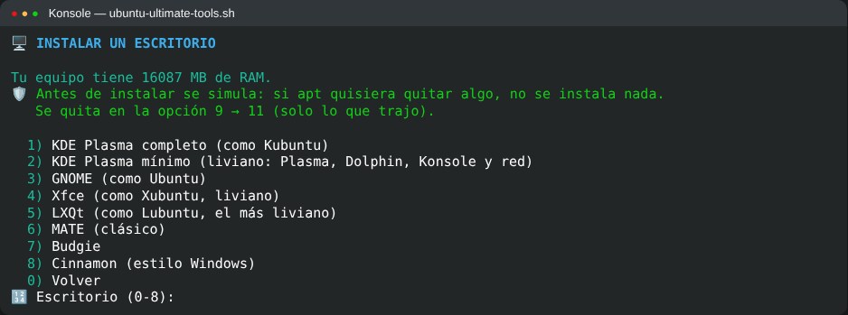

Primera opción de la lista de software opcional. Instala el escritorio que elijas encima de Ubuntu Server
(o al lado del que ya tengas), como hace `tasksel`, pero con protecciones:

| Escritorio | Paquete |
|---|---|
| KDE Plasma completo | `kubuntu-desktop` |
| KDE Plasma mínimo (liviano) | `plasma-desktop` + Dolphin, Konsole y red, sin recomendados |
| GNOME | `ubuntu-desktop-minimal` |
| Xfce | `xubuntu-desktop-minimal` (o `xubuntu-core`) |
| LXQt | `lubuntu-desktop` |
| MATE, Budgie, Cinnamon | sus metapaquetes de Ubuntu |

- **Solo Ubuntu**: en derivadas (Mint, Pop!_OS, Zorin...) el escritorio es parte de la distro y no se toca.
- **Se simula antes**: si apt fuera a **quitar un solo paquete**, no se instala nada. También revisa
  que el sistema de paquetes esté sano, el espacio libre y la RAM.
- **Si ya tienes escritorio**, se conserva tu pantalla de inicio de sesión (GDM, SDDM, LightDM).
- **Red**: en Server pasa la red a NetworkManager con `netplan try` (si en 60 s no confirmas, vuelve
  sola a como estaba). Por SSH no se cambia, para no dejarte sin conexión.
- **Otros escritorios** (instalados a mano o que ya venían): se quitan en la opción 10 → 12, con las mismas protecciones.
- **Se puede quitar**: opción 10 → 11 quita solo los paquetes que trajo, y vuelve el arranque y la red
  a como estaban (si quitarlo arrastrara algo que ya tenías, no se quita).

### 🤖 Compilar APK

Después de instalar las herramientas, en una terminal nueva:

```bash
cd mi-proyecto
./gradlew assembleDebug              # APK de prueba: app/build/outputs/apk/debug/
./gradlew tasks                      # proyectos con variantes: lista qué se puede compilar
```

- **NDK y CMake** (proyectos con C/C++): Gradle baja solo la versión exacta que pide el proyecto,
  porque ya aceptaste las licencias del SDK (el script te las muestra la primera vez).
- **Actualizar**: vuelve a usar la opción 7 → Compilar APK y se actualiza el SDK.
- El perfil `desarrollo` también instala las herramientas para compilar APK.
- **Quitar**: opción 10 → 7 (Android Studio y SDK; tus claves de firma en `~/.android` no se tocan)
  y 10 → 8 (SDK de Flatpak).

### 🐳 Compilar con Docker

Si el proyecto trae un `Dockerfile`, no hace falta instalar el SDK: Docker arma un contenedor con las
versiones exactas que eligió su autor.

```bash
cd mi-proyecto
docker build -t mi-compilador .                       # la primera vez tarda
docker run --rm -v "$PWD":/home/source mi-compilador  # la ruta la indica el README del proyecto
```

- Para usar `docker` sin `sudo`, el script ofrece sumar tu usuario al grupo `docker` (avisa que ese grupo
  equivale a ser administrador).
- Si había configuración de un Docker anterior, se guarda un respaldo antes de instalar.
- **Quitar** (opción 10 → 9): solo los programas, conservando imágenes y volúmenes; o la **eliminación
  nuclear**, que borra todo (datos, configuración y grupo) después de guardar un respaldo de la
  configuración y, si quieres, de tus volúmenes.

### 💾 Respaldos

Antes de borrar algo que no se puede recuperar, el script guarda un `.tar.gz` con fecha en
`~/respaldos-ubuntu-ultimate-tools/` (en Debian y Arch, `respaldos-debian-…` o `respaldos-arch-…`): la
configuración y los volúmenes de Docker, y tus claves de firma de Android (`~/.android`). Nunca se pisa un
respaldo anterior.

---

## 🗑️ Aplicaciones que puedes eliminar (opción 4)

Además de la lista conocida, **el script detecta solo todas las demás apps instaladas**, también en distros
derivadas que traen sus propias apps:

- **🔎 Detectadas en el menú:** cada app con ícono en el menú (`/usr/share/applications` y
  `/usr/local/share/applications`) se busca en el gestor de paquetes (`dpkg` en Ubuntu y Debian, `pacman` en Arch) y
  aparece con su **nombre y qué es**, en castellano si lo tiene (por ejemplo *"Configuración de GPU NVIDIA — Instale y
  administre el driver de video"*). También las herramientas propias de cada distro. No se ofrecen las ocultas, la
  terminal, las piezas del escritorio ni los paquetes que la distribución marca como imprescindibles (prioridad
  `required` o `important`).
- Las apps del menú que **no vienen de ningún paquete** (instaladas a mano) se nombran aparte: no se pueden quitar
  con el gestor de paquetes.
- **⚠ SISTEMA:** las herramientas del sistema o de tu distribución (configuración de la tarjeta gráfica, de red,
  de seguridad, gestores de particiones, terminales...) llevan esta marca en rojo. Se pueden quitar, pero si marcas
  alguna, el script pide confirmarlo nombrándolas.

  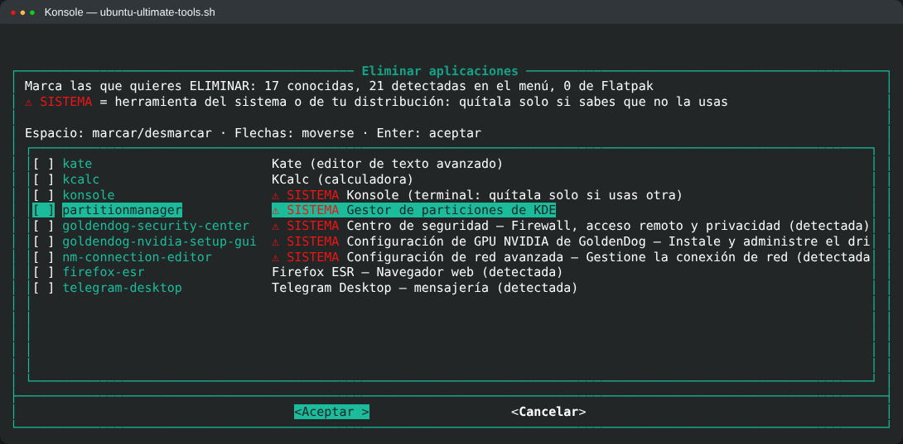

- **📦 Flatpak:** las apps de Flatpak instaladas (del sistema o del usuario) se quitan con `flatpak uninstall`, y
  después se limpian los runtimes que ya no usa ninguna.
- Al quitar, siguen valiendo las protecciones de siempre: si una app arrastrara una pieza esencial del sistema, no
  se quita, y se avisa qué otros paquetes se irían por dependencias.

La lista conocida sale de los **meta-paquetes reales de cada sabor**, con dos filtros:

- **Solo apps**: juegos, oficina, correo, multimedia, cámaras, escáneres, torrents, IRC, utilidades...
  Nunca se ofrecen las piezas del escritorio: gestor de archivos, configuración del sistema, panel, sesión,
  gestor de ventanas, red, sonido, Bluetooth, energía, notificaciones, portales o actualizaciones.
- **Solo las que tienes instaladas**: lista de tu escritorio + apps comunes a todos los Ubuntu.

Y un **seguro de dependencias**: antes de borrar, el script simula qué se llevaría el gestor de paquetes (`apt` o `pacman`). Si una app
arrastraría una pieza esencial (escritorio, sesión, gestor de inicio de sesión, red, sonido...), **no se
quita** y se explica por qué. Si arrastra otras cosas, se muestran antes de confirmar.

---

## 🔄 Flujo de trabajo recomendado

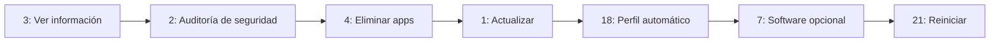

Si algo no te convence, la opción 10 deshace optimizaciones y quita programas, y la 11 vuelve a la distribución original.

---

## 🛡️ Seguridad

- ✅ **Reversible**: cada ajuste se puede deshacer (opción 10) y todo se puede revertir (opción 11).
- ✅ **Confirmaciones**: cada acción importante pide confirmación y muestra qué se va a cambiar.
- ✅ **Seguro de dependencias**: nunca quita una app que arrastre piezas esenciales del sistema.
- ✅ **Copias antes de tocar el arranque**: `/etc/default/grub` se guarda antes del primer cambio, y `/etc/grub.d` entero antes de deshacer Grub Customizer.
- ✅ **Kernel de respaldo**: el kernel oficial se conserva siempre y el que está en uso nunca se borra en caliente.
- ✅ **Aviso del primer uso**: antes de tocar nada explica la licencia y que el script modifica el sistema.
- ✅ **Registro**: todo queda en el log de cada script (`~/ubuntu-ultimate-tools.log`, `~/debian-ultimate-tools.log`
  o `~/arch-ultimate-tools.log`).

---

## 📸 Capturas

En la carpeta [**screenshots**](screenshots/) están las capturas de todos los menús: eliminar apps,
GPU, kernel, revertir, arranque y GRUB, red, energía, perfiles, deshacer, información del sistema,
Ubuntu Server, instalar un escritorio, auditoría de seguridad y crear un USB de instalación.

---

## ❓ Preguntas Frecuentes

**¿Funciona en mi sabor de Ubuntu?**

Sí: Ubuntu, Kubuntu, Xubuntu, Lubuntu, MATE, Budgie, Cinnamon, Unity, Studio, Edubuntu, Kylin y Server.
El banner muestra qué sabor y escritorio detectó. En distribuciones basadas en Ubuntu (Mint, Pop!_OS...)
funciona, pero está menos probado.

**¿Y en Debian, Arch, Manjaro o Fedora?**

Debian y sus derivadas tienen `debian-ultimate-tools.sh`, y Arch, Manjaro y EndeavourOS, `arch-ultimate-tools.sh`
(los dos en beta). En Fedora, openSUSE y otras sirven el menú de **arranque** (19: reparar y personalizar GRUB,
tarjeta de rescate, arranque de respaldo UEFI, reparación desde Live USB) y **descargar sistemas y crear un USB de instalación** (20).

**¿Qué pasa si elimino Snap?**

Se van Firefox y la tienda Snap. Al terminar, el script ofrece instalar **Firefox .deb del repositorio oficial de
Mozilla** (en Ubuntu `apt install firefox` solo instala el snap); también está en la opción 7. Snap se puede
reinstalar con la opción 9.

**¿Cómo vuelvo atrás?**

Para quitar ajustes o programas sueltos, usa la opción 10. Para volver del todo, la opción 11: reinstala el meta-paquete de tu sabor con todas sus apps y restaura Snap.

**¿Usaba la versión anterior, "Kubuntu Lite"?**

No hace falta hacer nada: la primera vez que ejecutes `ubuntu-ultimate-tools.sh`, pasa sola tu configuración
(entradas ocultas de GRUB, programas instalados, ajustes de RAM, DNS, etc.) a los nombres nuevos.

**¿Necesito reinstalar después de ejecutar el script?**

No es necesario, pero se recomienda reiniciar para aplicar todos los cambios correctamente.

---

## 🤝 Contribuciones

Las contribuciones son bienvenidas. Puedes:

1. Reportar errores en [Issues](https://github.com/george0884/linux-ultimate-tools/issues)
2. Sugerir nuevos programas para incluir en la lista opcional
3. Mejorar la documentación

### 🧩 Cómo está organizado el código

Los tres scripts comparten mucho código (crear USB y Ventoy, GRUB, auditoría, red, energía...). Para no
editarlo tres veces, se guarda en piezas dentro de `partes/` y `armar.sh` las une:

```
partes/
  comun.sh  usb.sh  arranque.sh  auditoria.sh   ← compartidas por los tres
  apt.sh                                        ← compartida por Ubuntu y Debian
  ubuntu.sh  debian.sh  arch.sh                 ← lo propio de cada uno y el orden del script

bash armar.sh   →   ubuntu-ultimate-tools.sh   debian-ultimate-tools.sh   arch-ultimate-tools.sh
```

- **Para usarlo no cambia nada**: cada script sigue siendo un solo archivo completo, que se baja y se ejecuta igual.
- **Para cambiar algo**: edita la pieza en `partes/`, corre `bash armar.sh` y sube las piezas y los scripts.
  No edites los scripts finales a mano: la próxima vez que se armen, se pierde el cambio.
- En cada PR, GitHub comprueba que los scripts coincidan con las piezas, la sintaxis y ShellCheck.

---

## 📄 Licencia

Este proyecto está bajo la licencia **GNU AGPL v3** (o posterior). Ver el archivo [LICENSE](LICENSE).

En resumen: puedes usar, copiar, modificar y compartir los scripts libremente. Si distribuyes una
versión modificada, o la ofreces como servicio por red, debes publicar su código fuente bajo la
misma licencia AGPL v3.

### Aviso del primer uso

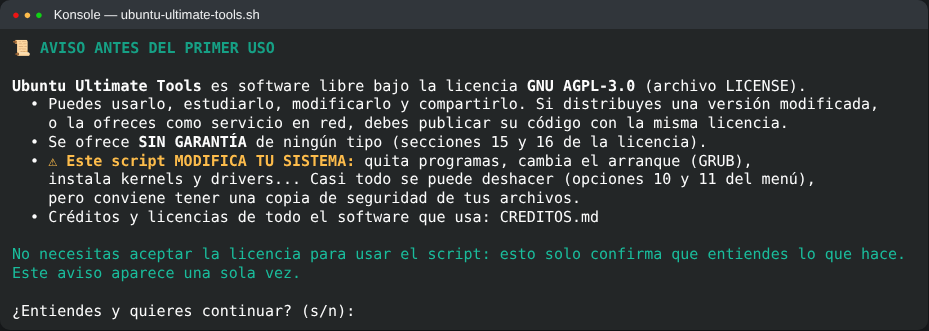

La primera vez que se ejecuta, el script muestra un aviso **antes de pedir la contraseña o tocar nada**: la licencia,
que no tiene garantía, que **modifica el sistema** (y que casi todo se deshace con las opciones 10 y 11) y dónde están
los créditos. Si respondes que no, se cierra sin cambiar nada. Si respondes que sí, no vuelve a aparecer.

No es una condición para usar el programa: la AGPL permite ejecutarlo sin aceptar la licencia (sección 9), así que
el aviso solo confirma que entiendes lo que hace. Para servidores o tareas programadas, después de leerlo, agrega
`--entiendo`.

## 🙏 Créditos

El script instala software de muchos proyectos, cada uno con su propia licencia (algunos son
privativos, como Steam, Chrome, Discord, Spotify o los drivers de NVIDIA, y los instalas aceptando
sus condiciones). La lista completa con autores y licencias está en [CREDITOS.md](CREDITOS.md).

Las licencias del **SDK de Android** son de Google: el script te las muestra y las aceptas tú.

**Marcas:** este proyecto no está afiliado a Canonical, Debian, Arch Linux, Manjaro, KDE, Mozilla,
Brave, Google, Microsoft, Valve ni NVIDIA. Los nombres y logotipos son de sus dueños y se usan solo
para indicar compatibilidad.

---

<div align="center">

**👤 Autor:** Oldtheone – [george0884](https://github.com/george0884)

</div>

---

<div align="center">

⭐ ¿Te fueron útiles estos scripts? ¡Dale una estrella en GitHub!

</div>
